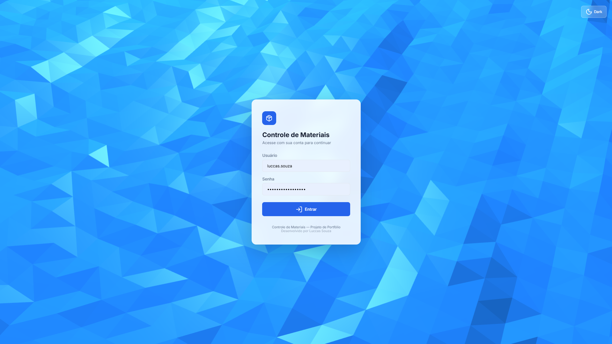
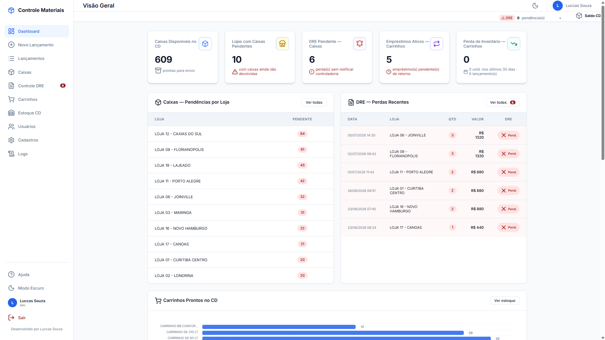
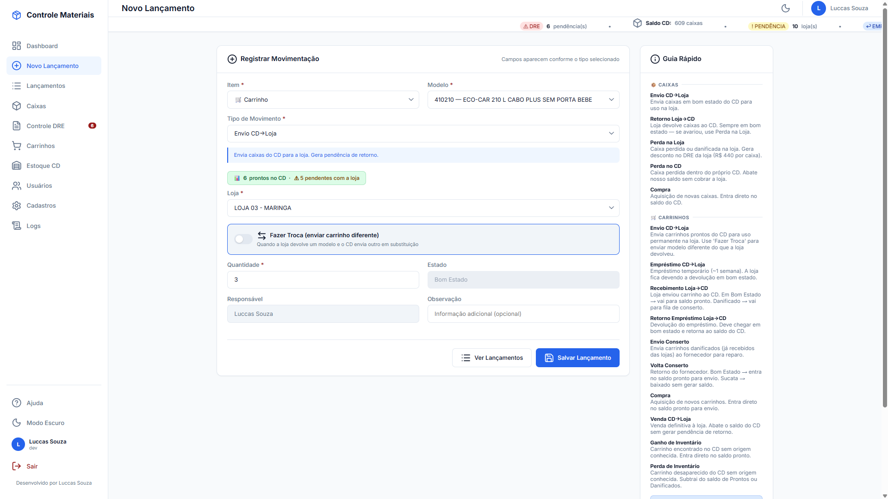
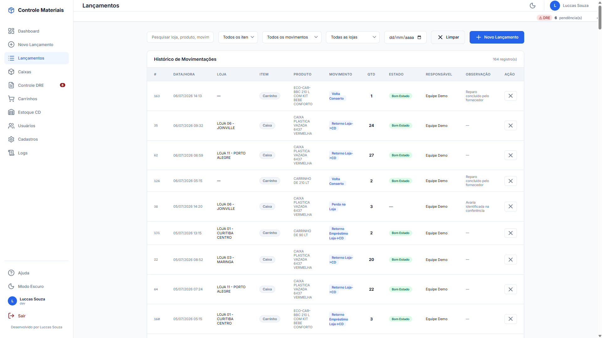
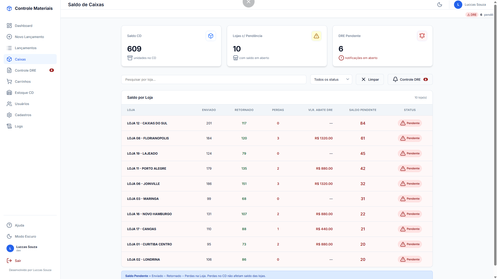
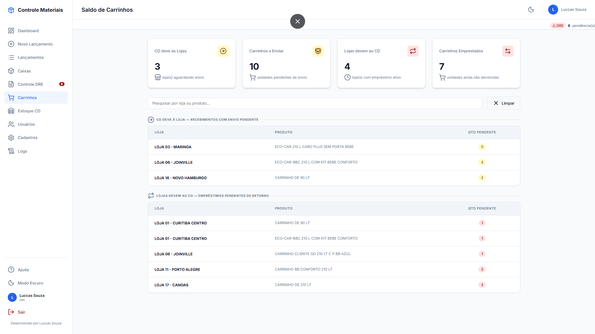
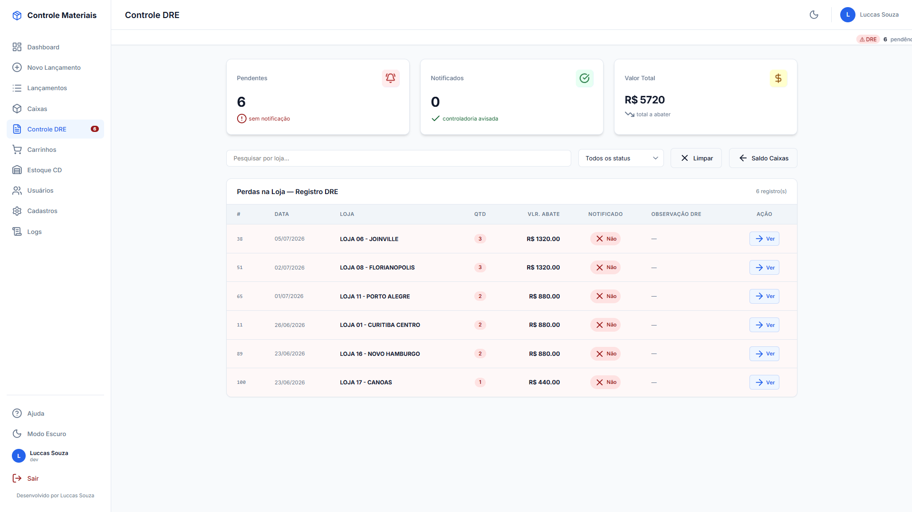
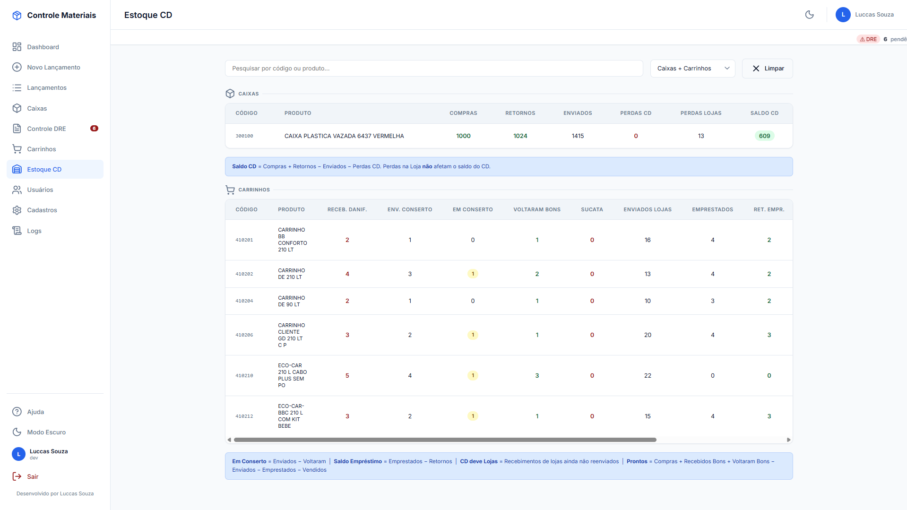

# 📦 Controle de Materiais: CD & Lojas


Sistema web de **controle de ativos retornáveis** (caixas e carrinhos) entre um Centro de Distribuição
e as lojas de uma rede varejista, com rastreabilidade completa, permissões granulares por usuário e
trilha de auditoria.

> 🖥️ **Demo ao vivo:** https://controle-materiais-k7xc.onrender.com
>
> 🔑 **Acesso de visitante (somente leitura):** usuário `visitante` · senha `demo12345`
>
> ⚠️ *Este repositório é a versão pública de portfólio: nomes de lojas, produtos e dados são
> fictícios. O sistema original roda em produção na operação logística de uma rede varejista real,
> não identificada por confidencialidade.*
>
> 💤 *O plano gratuito do Render hiberna o servidor: o primeiro acesso pode levar ~30s para acordar.*

---

## 🎯 O problema

Em um CD que abastece **mais de 30 lojas**, milhares de caixas plásticas e centenas de carrinhos
circulam continuamente: vão carregados para as lojas e precisam voltar. Sem um controle central:

- ninguém sabia **quantas caixas cada loja estava devendo** ao CD;
- carrinhos emprestados, em conserto no fornecedor ou vendidos se misturavam sem rastreio;
- **perdas não geravam cobrança**: caixas de R$ 440/unidade sumiam sem responsável;
- o "controle" vivia em planilhas paralelas, sem validação, sem histórico e sem dono.

## ✅ O resultado

O sistema em produção mapeou **31 lojas e 12 modelos de carrinhos**, com **centenas de movimentações
registradas por mês**, e passou a responder em segundos perguntas que antes exigiam ligações e
conferências manuais:

- 📦 saldo de caixas do CD e a pendência exata de cada loja, em tempo real;
- 🛒 situação de cada modelo de carrinho: prontos, emprestados, em conserto, vendidos ou sucateados;
- 💰 perdas viram automaticamente **débito de DRE por loja** (R$/unidade), com fila de notificação à controladoria;
- 📜 histórico imutável de toda movimentação, com responsável, data e auditoria.

## 💡 Por que um sistema e não uma planilha?

Quando o projeto nasceu, as **regras de negócio ainda estavam sendo criadas**: a cada semana surgia
um fluxo novo (empréstimo, troca de modelos, conserto, perda de inventário...). Uma planilha até
registra dados, mas **não valida regra, não controla acesso e não conta a história** de cada ativo.

A decisão foi construir um sistema web próprio, usando **IA como ferramenta de desenvolvimento**
para acelerar a entrega, com as regras de negócio, a arquitetura e os testes definidos e validados
por mim. Três motivos sustentaram a escolha:

1. **Velocidade de manutenção**: uma regra nova vira código validado no servidor em horas, não em
   semanas. O repositório mantém documentação viva ([`CLAUDE.md`](CLAUDE.md) e este README) com as
   invariantes de arquitetura, o que torna a evolução do sistema segura e previsível.
2. **Governança de dados**: permissões individuais por usuário, validação no servidor, trilha de
   auditoria e histórico imutável. Coisas que planilha nenhuma oferece.
3. **Custo**: contratar um desenvolvimento tradicional não se justificava para uma ferramenta
   interna. O sistema inteiro roda em infraestrutura gratuita (Supabase + Render) e é mantido por
   uma única pessoa da operação.

## 📸 Telas

| | |
|---|---|
| **Login** (dark/light mode)  | **Dashboard** com KPIs e pendências  |
| **Novo lançamento** com saldo em tempo real  | **Histórico** com filtros  |
| **Saldo de caixas** por loja  | **Carrinhos**: dívidas e empréstimos  |
| **Controle DRE** de perdas  | **Estoque do CD** consolidado  |

## ⚙️ Funcionalidades

| Área | O que faz |
|---|---|
| **Lançamentos** | 15 tipos de movimento entre CD e lojas (envio, retorno, compra, venda, empréstimo, conserto, perdas, trocas de modelo, ajustes de inventário), com validação de saldo em tempo real |
| **Saldos** | Nenhuma coluna de estoque: todo saldo é calculado por agregação sobre o histórico (padrão *event sourcing* simplificado), o que torna impossível "ajustar" estoque sem deixar rastro |
| **DRE de perdas** | Perda na loja gera débito automático (R$ 440/caixa) e fila de pendências para notificação à controladoria |
| **Permissões** | Flags individuais por usuário (checkboxes): quais movimentos pode lançar e quais telas administrativas acessa; perfis funcionam como modelos editáveis |
| **Usuários** | Username gerado automaticamente (`primeiro.ultimo`), bloqueio após 5 senhas erradas, inativação de desligados |
| **Auditoria** | Tela de logs com logins, falhas, bloqueios e ações administrativas, com auto-limpeza (máx. 5.000 registros / 90 dias) para caber no plano gratuito |
| **UX** | Dark/light mode, mobile responsivo, saldo disponível exibido antes de salvar, ticker de indicadores |

## 🔒 Segurança (implementada, não prometida)

- Autenticação server-side com **bcrypt**, sessão única por usuário e expiração de 12h validada no servidor
- Autorização por flags **em toda rota** (o front só esconde botões)
- **CSRF** em todos os formulários · **rate limiting** por IP · bloqueio de conta por tentativas
- SQL 100% **parametrizado** · validação e whitelist de todos os inputs no servidor
- **RLS** habilitado em todas as tabelas · segredos apenas em variáveis de ambiente
- Security headers (CSP, X-Frame-Options, nosniff) · erros sem vazamento de stack trace
- E-mails mascarados nas listagens (minimização de dados pessoais)

## 🏗️ Arquitetura

```
Navegador ──HTTPS──► Render (Gunicorn + Flask + Jinja2) ──pg8000/TLS──► Supabase (PostgreSQL)
                     · 1 conexão de banco por request (flask.g)         · RLS em todas as tabelas
                     · CSRF, rate limit, security headers               · migrations idempotentes no boot
                     · caches em memória (60s)
```

**Decisões técnicas conscientes:**
- **Sem ORM e sem framework JS**: SQL direto parametrizado e HTML/CSS/JS puro. Menos dependências,
  mais controle, deploy em segundos;
- **Saldo por agregação** (`SUM` sobre o histórico) em vez de coluna de estoque: consistência
  garantida e auditabilidade total;
- **1 conexão de banco por request** via `flask.g`: otimização que reduziu o tempo de resposta em ~80%;
- **Migrations idempotentes** executadas no boot: deploy é só um push, sem passos manuais de banco.

## 🛠️ Stack

`Python 3.11` · `Flask 3` · `Jinja2` · `PostgreSQL (Supabase)` · `pg8000` · `Gunicorn` · `Render` ·
`HTML/CSS/JS puro` · `ApexCharts` · `Lucide`

## 🚀 Rodando localmente

```bash
git clone https://github.com/luccas-souza7/controle-materiais.git
cd controle-materiais
pip install -r requirements.txt

# PowerShell (Windows)
$env:DATABASE_URL = "postgresql://..."   # projeto no Supabase (o boot cria as tabelas sozinho)
$env:DEV_PASSWORD = "uma-senha-forte"    # cria o usuário administrador no primeiro boot

python app.py                             # http://localhost:5000
```

Para popular o ambiente com **dados de demonstração** (movimentações fictícias de 60 dias):

```bash
python seed_demo.py
```

## 📋 Changelog

| Versão | Descrição |
|---|---|
| **v2.0** | Correção da Venda CD→Loja de carrinhos. Permissões individuais por checkbox (perfil vira modelo editável; somente Dev tem acesso total fixo). Username automático. Performance: 1 conexão de banco por clique. Proteção CSRF, limite de tentativas por IP, sessão com expiração de 12h, logs de atividade com limpeza automática, e-mails mascarados e RLS no banco |
| v1.4 | Layout StockFlow: sidebar, ticker animado, dark/light mode, KPI cards, gráfico ApexCharts, tela de cadastros de lojas e itens, mobile responsivo |
| v1.3 | Saldo disponível em tempo real no formulário, filtros em todas as abas, empréstimos com validação por loja e modelo |
| v1.2 | Sistema de perfis de acesso, bloqueio automático após 5 tentativas, sessão única por usuário |
| v1.1 | Fluxo completo de conserto (envio/volta/sucata), Controle DRE com pendências, dashboard com gráfico de estoque |
| v1.0 | Versão inicial: controle de caixas, lançamentos por loja, saldo do CD, login com bcrypt |

## 👤 Autor

**Luccas Souza** · Análise e Planejamento Logístico

[](https://linkedin.com/in/luccas-souza7)
[](https://github.com/luccas-souza7)
[](mailto:luccasnsouza1@gmail.com)
[](https://wa.me/5511932018859)
